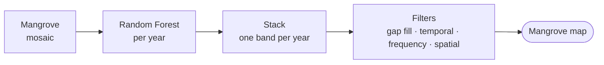

<p align="center">
  
  
</p>

# 🌿 MapBiomas Ecuador – Mangroves

Google Earth Engine scripts used by **MapBiomas Ecuador** ([EcoCiencia](https://www.ecociencia.org/)) to map **mangroves** in Ecuador, year by year, from Landsat imagery. Mangroves are one of the **cross-cutting themes** of MapBiomas Ecuador and are mapped in Collections 3 and 4.

## 🌱 What is a cross-cutting theme?

Some land-cover classes are hard to separate in the general land-cover map. For them, MapBiomas develops **cross-cutting themes**: specific methods that map **a single class of interest** independently from the general map. During the **integration** of each collection, the result of each cross-cutting theme is incorporated into the final land-cover map using hierarchical rules.

## 🌳 Mangroves in Ecuador

Mangroves are key coastal ecosystems: they protect the coast against erosion, are habitat for many species and store large amounts of carbon. Monitoring them requires a continuous time series, built here from Landsat images with Random Forest classification.

| Class | Value | Definition |
|---|---|---|
| Mangrove | `5` | Dense, evergreen natural forests of the coast, in the transition zone between the ocean and the mainland (García Murcia & Cortés, 2023; MapBiomas, 2018). They grow on sandy or clayey-silty soils that are permanently or occasionally flooded by the tides, forming belts in estuaries, bays, inlets, coastal lagoons and river mouths, under the influence of both continental runoff and sea water. |
| Other | `27` | Everything else. |


## 🗂️ Collections

| Collection | Folder | Period | Status |
|---|---|---|---|
| Collection 3 | [`collection_3/`](collection_3/) | 1985–2024 | Published |
| Collection 4 | [`collection_4/`](collection_4/) | 1985–2025 | Published – see its [README](collection_4/README.md) |

## 🔁 Method

Both collections use a **mosaic built only for mangroves**: Landsat Collection 2 TOA scenes of the coast and the Galápagos (Landsat 5, 7 and 8 before 2014; Landsat 8 and 9 from 2014), with indices for vegetation and coastal water such as MNDWI and MMRI (Modular Mangrove Recognition Index). The classification separates mangrove from everything else with **Random Forest**, region by region, and the time series is then corrected with post-classification filters.



| Step | Collection 3 | Collection 4 | What it does |
|---|---|---|---|
| Mosaic | `P01-mosaic-generator.js` | `P01-mangrove-mosaic.js` | Annual mangrove mosaic |
| Classification | `P02-classification.js` | `P02-classification.js` | Random Forest per year |
| Stack | `P03-stack-multiband.js` | `P03-stack-multiband.js` | One image with a band per year |
| Gap fill | `P04-gapfill-filter.js` | `P04-gapfill-filter.js` | Fills years with no mosaic data with the neighboring years |
| Temporal filter | `P05-temporal-filter.js` | `P05-temporal-filter.js` | Corrects interruptions of 1 to 3 years and the first and last years |
| Frequency filter | `P06-frequency-filter.js` | `P06-frequency-filter.js` | Pixels that are mangrove in more than 75 % of the years become mangrove in every year |
| Spatial filter | `P07-spatial-filter.js` | `P07-spatial-filter.js` | Removes small isolated patches (salt and pepper) |
| Statistics / Integration | `P08-statistics.js` (area charts and statistics) | `P08-integration.js` (national map) | |

In Collection 4, the years 1985–2023 of the stack come from Collection 3, and only the newest years are classified again.

## 📂 Repository structure

```
ecuador-mangroves/
├── readme.md                     # This page
├── collection_3/                 # Collection 3
│   ├── P01-mosaic-generator.js
│   ├── ...
│   └── P08-statistics.js
└── collection_4/                 # Collection 4
    ├── README.md                 # Detailed description of each step and versions
    ├── P01-mangrove-mosaic.js
    ├── ...
    └── P08-integration.js
```

## 🚀 How to use

1. Get a [Google Earth Engine](https://earthengine.google.com/) account and open the [Code Editor](https://code.earthengine.google.com/).
2. Choose the collection and open its scripts in order, or paste them into new scripts.
3. Edit the parameters at the top of each script and click **Run**.
4. For Collection 4, follow its [README](collection_4/README.md): it explains each step, the inputs and outputs, and the version numbers that connect the scripts.

## 🔗 Related

- MapBiomas Ecuador land-cover and land-use scripts (general map): `ecuador-lulc` repository.
- MapBiomas Ecuador platform: [ecuador.mapbiomas.org](https://ecuador.mapbiomas.org/).

## 👥 Authors

MapBiomas Ecuador team (EcoCiencia), with the MapBiomas Amazonía / RAISG development team.

### Contact and more information

This initiative is part of the MapBiomas Network, coordinated by MapBiomas Ecuador. More information at [ecuador.mapbiomas.org](https://ecuador.mapbiomas.org/).
