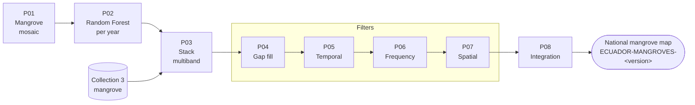

<p align="center">
  
  
</p>

# 🌿 Mangrove – Cross-cutting Theme (Collection 4)

Scripts used by **MapBiomas Ecuador – Collection 4** to map **mangroves** (class `5`) on the Ecuadorian coast, year by year from 1985 to 2025, with Landsat imagery and Google Earth Engine. The result is a national map with two classes: mangrove (`5`) and other (`27`).

## 🌎 Overview

Mangroves have their own **annual mosaic** (P01), built only for the Landsat scenes of the coast and with indices designed for mangroves and coastal water. The classification and the filters run one **mangrove region** at a time (field `regionID` of the mangrove regions asset); P08 joins all regions into the national map.



| Class | Value |
|---|---|
| Mangrove | `5` |
| Other | `27` |

## 🛰️ Mangrove mosaic (P01)

| | |
|---|---|
| Images | Landsat Collection 2 Tier 1 **TOA**: Landsat 5, 7 and 8 before 2014; Landsat 8 and 9 from 2014 |
| Scenes | 16 path/rows of the coast, cloud cover ≤ 90 %, minus the scenes of the blacklist |
| Masks | Clouds, dilated clouds and cloud shadows (`QA_PIXEL`) |
| Composite | Median of all the scenes of the year, clipped to the path/row grid |
| Bands (byte, 0–255) | `swir2`, `swir1`, `nir`, `red`, `green` (× 255) · `NDVI`, `MNDWI`, `MMRI`, `NDSI`, `NDWI` ((value + 1) × 127) · `IM1`, `IM2` (fixed stretch) · `BQA` |
| Output | `projects/mapbiomas-raisg/MOSAICOS/mangrove-5/ECUADOR-<year>` (property `year` stored as text) |

**Indices.** **MMRI** (Modular Mangrove Recognition Index) combines MNDWI and NDVI to separate mangroves from other vegetation and from water. **IM1** (total nitrate) and **IM2** (total phosphorus) are water-quality indices computed from the red and green bands.

## 🔍 How each step works

| Script | What it does |
|---|---|
| **P01 – Mangrove mosaic** | Builds the annual mosaic described above. Each scene can be shown as a layer to find bad scenes and add them to the blacklist. |
| **P02 – Classification** | Random Forest (100 trees) per year with 10 bands of the mosaic: `swir1`, `swir2`, `nir`, `red`, `green`, `NDVI`, `MNDWI`, `MMRI`, `NDSI`, `NDWI`. Training points: **stable points** (the same in every year) plus optional points of each year. Optional polygons force class 27. Exports the classification and the samples. |
| **P03 – Stack multiband** | Builds one image with a band per year (1985–2025): class 27 in every year, replaced by the years of Collection 3 (1985–2023), replaced by the new years classified with P02 (2024–2025). |
| **P04 – Gap fill** | Pixels with no mosaic data become gaps and take the class of the neighboring years, in two independent periods (see below). |
| **P05 – Temporal filter** | Removes short interruptions of mangrove (1 to 3 years) and fixes the first and last years. |
| **P06 – Frequency filter** | Pixels that are mangrove in more than 75 % of the years become mangrove in every year. |
| **P07 – Spatial filter** | Year by year, patches smaller than 10 pixels take the most frequent class of an 11 × 11 window. |
| **P08 – Integration** | Mosaics the final version of every region (`REGION_VERSIONS`); where regions overlap, the region listed last is kept. Everything else inside Ecuador becomes 27; pixels outside Ecuador are masked. |

**P04 in detail** (`-` = no mosaic data). The series is split in two periods that are filled separately:

```
1985–2000, forward then backward:   -  5  - 27  -   ->   5  5  5 27 27
2001–2025, backward then forward:   -  5  - 27  -   ->   5  5 27 27 27
```

**P05 in detail** (rules applied in the order of `filterExecution`):

```
5 27 5          ->  5 5 5           middle3
5 27 27 5       ->  5 5 5 5         middle4 + middle3
5 27 27 27 5    ->  5 5 5 5 5       middle5 + middle4 + middle3
5 27 27         ->  27 27 27        first3 (class 27, first year)
5  5 27         ->  5  5  5         last3 (class 5, last year)
```

**P06 in detail** (41 years, 75 % = 30.75 years):

```
5 5 27 5 ... 5     (35 years of 5)  ->  5 in every year
5 27 27 5 ... 27   (20 years of 5)  ->  unchanged
```

**P07 in detail** (`minConnectedPixels` = 10):

```
patch of 5 with 6 pixels inside 27  ->  becomes 27
patch of 5 with 25 pixels           ->  unchanged
```

## 📂 Scripts

| Script | Input | Output |
|---|---|---|
| [`P01-mangrove-mosaic.js`](P01-mangrove-mosaic.js) | Landsat C2 TOA | `MOSAICOS/mangrove-5/ECUADOR-<year>` |
| [`P02-classification.js`](P02-classification.js) | Mosaic (P01), training points | `pathMangrovesClasificationPre` · `ECUADOR-<region>-<year>-<v>` and samples (`pathMangrovesSamplesAct`) |
| [`P03-stack-multiband.js`](P03-stack-multiband.js) | Annual images of P02, Collection 3 | `pathMangrovesClasificationAct` · `ECUADOR-<region>-<v>` |
| [`P04-gapfill-filter.js`](P04-gapfill-filter.js) | Output of P03, mosaics | `STEP03-CLASSIFICATION/classification-ft` · `ECUADOR-<region>-<v>` |
| [`P05-temporal-filter.js`](P05-temporal-filter.js) | Output of P04 | `pathMangrovesClasificationFilterAct` |
| [`P06-frequency-filter.js`](P06-frequency-filter.js) | Output of P05 | same folder |
| [`P07-spatial-filter.js`](P07-spatial-filter.js) | Output of P06 | same folder |
| [`P08-integration.js`](P08-integration.js) | Final version of every region (`classification-ft`) | `.../MANGROVE/STEP04-INTEGRATION/ECUADOR-MANGROVES-<v>` |

The asset folders (`path...`) come from the module `CollectionDirectories.js`.

### Versions

Each script reads the output of the previous one by **version number**. Default chain for one region:

| Script | Reads | Writes |
|---|---|---|
| P02 | – | 999 |
| P03 | 999 | 998 |
| P04 | 998 | 997 |
| P05 | 997 | 996 |
| P06 | 996 | 995 |
| P07 | 995 | 994 |
| P08 | final version of each region | 1 |

P04 to P07 write to the **same folder**, so each one needs a different version number.

## 🚀 How to use

1. Sign in to the [GEE Code Editor](https://code.earthengine.google.com/).
2. Open the script from the repository `users/mapbiomasecuador/LULC` or paste it into a new script.
3. Set `regionId` and the versions in `PARAMS`. Each parameter is documented in place.
4. Click **Run** and compare the layers **Mosaic**, **Original** and the filtered result for the preview years. The filters also print area charts (ha) in the console: input, filtered and Collection 3. They are computed at 250 m, so use them as a reference only.
5. Start the export from the **Tasks** tab.
6. Run P01 once per year, then P02 → P07 for each mangrove region, and P08 once for the whole country.

**Drawn points and polygons.** Draw or import them in the Code Editor as FeatureCollections and pass their names in `PARAMS`:

| Script | Parameter | Properties |
|---|---|---|
| P02 | `stablePoints` | `reference` (5 or 27) |
| P02 | `additionalSamples` | `reference` and `year` |
| P02 | `exclusion` | `id` = 27 |
| P06 | `applyArea` | – (filter only inside) |
| P06 | `remapAreas` | `original` and `new`, e.g. `original: '27'`, `new: '5'` |
| P06 | `exclusion` | – (input kept inside) |

## 🧰 Requirements

- A [Google Earth Engine](https://earthengine.google.com/) account.
- Code Editor modules (loaded with `require`, must be public):
  - `users/mapbiomasecuador/LULC:COLECCION4/05-modules/CollectionDirectories.js` – asset paths.
  - `users/mapbiomasecuador/LULC:MODULES/Palettes.js` – Collection 4 color palette.
- Input assets: Landsat path/row grid of the coast, mangrove regions, Collection 3 mangrove classification, MapBiomas Ecuador Collection 3 map (charts), country boundary (P08).

## 👥 Authors

Fabricio Garcés and MapBiomas Ecuador team (EcoCiencia), with the MapBiomas Amazonía / RAISG development team.

### Contact and more information

This initiative is part of the MapBiomas Network, coordinated by MapBiomas Ecuador. More information at [ecuador.mapbiomas.org](https://ecuador.mapbiomas.org/).
